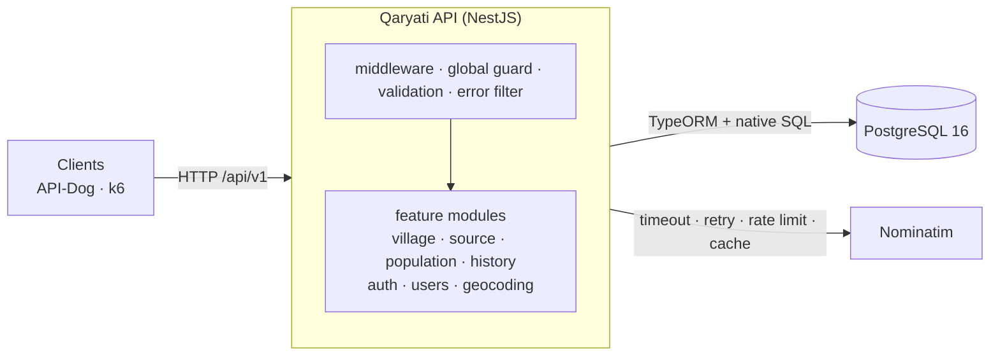

# Qaryati – Palestinian Villages Knowledge Platform

Backend API that stores structured, sourced information about Palestinian
villages: identity and names, administrative affiliation, geography,
population history, history and heritage, local economy and facilities.

Stack: **NestJS (TypeScript) · PostgreSQL 16 · TypeORM · Docker**.

## Quick start

```bash
cp .env.example .env          # then set DB_PASSWORD
docker compose up -d --build  # API on :3000, Postgres on :5433
```

- Health: <http://localhost:3000/api/v1/health>
- Swagger UI: <http://localhost:3000/api/docs>
- OpenAPI JSON (import into API-Dog): <http://localhost:3000/api/docs-json>

### Local development (API outside Docker)

```bash
npm ci
docker compose up -d db
npm run start:dev
```

### Tests

```bash
npm test            # unit tests
npm run test:e2e    # e2e tests (needs `docker compose up -d db`)
npm run lint:check
npm run typecheck   # type-checks src and test, including *.spec.ts
```

### Migrations

The schema changes only through migrations (`synchronize` is off).
They run automatically on startup (`DB_RUN_MIGRATIONS=true`).

```bash
npm run migration:generate src/database/migrations/AddPopulationRecords  # from entity changes
npm run migration:create src/database/migrations/AddSearchIndexes        # empty, hand-written
npm run migration:run
npm run migration:revert
```

### Seed data

```bash
npm run seed                          # real villages + alternative names (safe to re-run)
npm run seed:perf                     # 50,000 synthetic villages for k6 load tests
npm run seed:perf -- --count 20000    # a chosen number instead
npm run seed:perf -- --clear          # remove all synthetic rows
```

- `npm run seed` adds about 116 real villages in all 16 governorates and some
  well-known alternative and historical names. Existing rows are never
  overwritten. Population figures and source citations are not seeded: they
  should be entered with their real provenance.
- `npm run seed:perf` is only for performance testing. Synthetic villages have
  an English name starting with `PERF `, and the same names are generated on
  every run, so before/after measurements compare the same data. It refuses
  to run with `NODE_ENV=production`.

### Load tests (k6)

```bash
npm run seed:perf                        # the data set the tests are measured on
npm run build && node dist/main          # run the API from the production build
k6 run k6/search-read-heavy.js           # read-heavy: GET /villages/search
```

Results and analysis: [docs/performance/search.md](docs/performance/search.md).
Trigram indexes made search about 22× faster at p95 (470 ms → 22 ms) with 50
concurrent users on 50,000 villages.

## Architecture

A **modular monolith**: one NestJS application and one PostgreSQL database,
split into feature modules that each team member owns
([ADR-001](docs/adr/001-modular-monolith.md)).



- Inside a module: **controller → service → repository**, with DTOs for input
  validation and response shaping.
- Modules talk only through **exported services**, never through another
  module's tables. Shared code lives in `src/common/`.
- Data rules (unique names, valid years, foreign keys) are enforced by
  **database constraints** and mapped to clear `409`/`422` errors.
- Conflicting facts from different sources are stored as **separate
  records** (`PENDING → VERIFIED / REJECTED`) and never silently overwritten.

Full description with module, request-flow and CI diagrams:
**[docs/architecture.md](docs/architecture.md)**.

## Project structure

```
src/
  main.ts, setup-app.ts     bootstrap: /api/v1 prefix, validation, error filter, Swagger
  config/                   typed config + startup validation of env vars
  database/                 TypeORM options, CLI data source, migrations/
  common/                   shared building blocks (errors, pagination, logging, base entity)
  health/                   GET /api/v1/health
  modules/<feature>/        one folder per feature module (controller, service, dto, entities)
```

## API conventions

- All endpoints are under `/api/v1/...`.
- List endpoints accept `page`, `limit` (max 100), `sort`, `order`, and return
  `{ data: [...], meta: { page, limit, total, totalPages } }`.
- Every error has the same shape:

```json
{
  "error": {
    "code": "VALIDATION_ERROR",
    "message": "Request validation failed",
    "details": [{ "field": "page", "messages": ["page must not be less than 1"] }],
    "path": "/api/v1/villages?page=0",
    "timestamp": "2026-10-27T12:08:16.885Z",
    "correlationId": "88c9b01e-…"
  }
}
```

- Send `x-correlation-id` to trace a request; it is echoed in the response,
  the logs, and error bodies.

## Population data rules

- A population value of `0` is valid and represents a documented depopulated
  village; negative values are invalid.
- Population records retain the reviewer through `reviewed_by_id`, which
  restricts deleting a referenced user. Deactivate reviewers with
  `is_active = false` instead of deleting their accounts, so the review
  history remains attributable.

## Team

| Member | Area |
|---|---|
| Rashad | Village core, search, project infrastructure |
| Lina | Auth, users, roles, audit log, security config |
| Ahmad | Sources/provenance, population, history, heritage |
| Yahya | Geography, external geocoding API, economy, facilities |

See [CONTRIBUTING.md](CONTRIBUTING.md) for the Git workflow,
[docs/architecture.md](docs/architecture.md) for the architecture and
[docs/adr](docs/adr) for architecture decisions.
