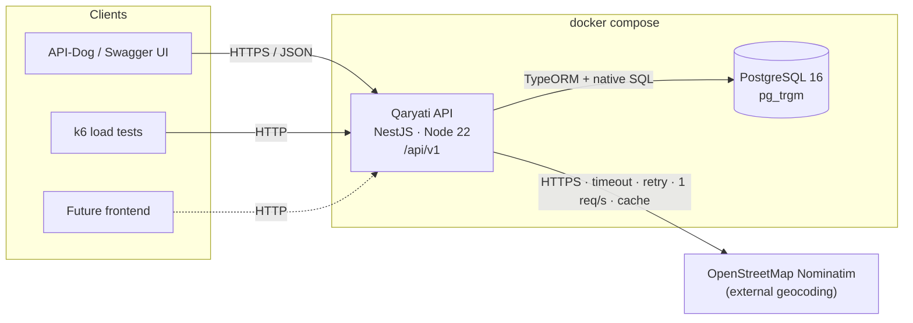
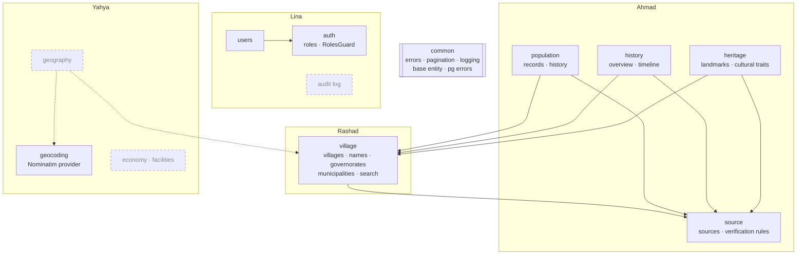
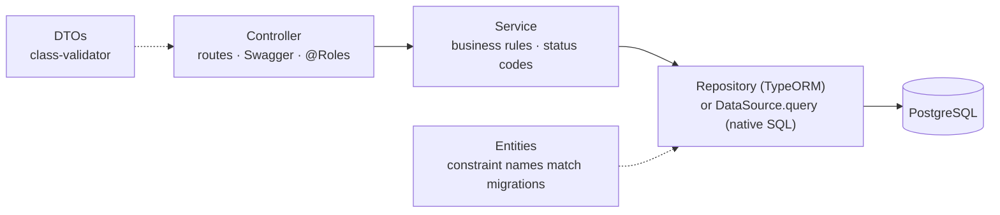
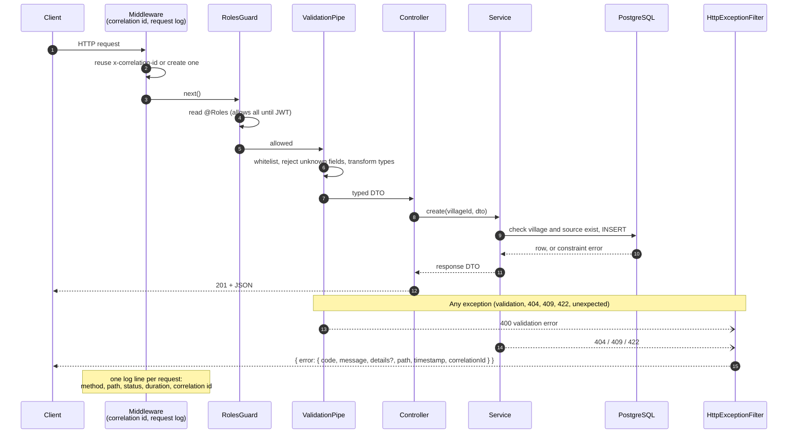
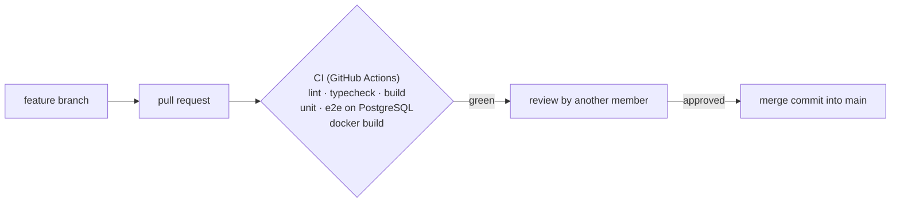

# Architecture

Qaryati is a **modular monolith**: one NestJS application and one PostgreSQL
database, split internally into feature modules with clear boundaries. The
reasons are in [ADR-001](adr/001-modular-monolith.md).

## 1. System overview



- **One deployable unit.** The API container is built by a two-stage
  [Dockerfile](../Dockerfile): it compiles TypeScript, then ships only the
  production dependencies and runs as a non-root user. `docker compose up`
  starts it together with PostgreSQL. The API waits until the database
  health check passes.
- **The schema changes only through migrations** (`synchronize` is off). They
  run automatically on startup, so every laptop, CI and Docker get the same
  schema.
- **Configuration** comes from environment variables and is validated at
  startup ([env.validation.ts](../src/config/env.validation.ts)). A missing or
  invalid value stops the app instead of failing later. Secrets live only in
  `.env`, which is never committed.

## 2. Modules

Each feature lives in `src/modules/<feature>/` and is owned by one team
member. Arrows show "uses the exported service of".



Dashed boxes are planned modules that are not merged yet. Every module uses
`common`. `auth` registers `RolesGuard` globally, so it applies to every
route without other modules importing it.

**Boundary rules** (checked in code review):

- A module uses another module only through its **exported service**, imported
  from the module's public `index.ts` where it has one, for example
  `import { SourceService } from '../source'`.
  It never injects another module's repository or queries its tables.
- Relations between entities of different modules are declared by **entity
  name** (`@ManyToOne('Village')`), so a module never imports another
  module's entity class. The foreign key still exists in the database.
- Shared building blocks that are not a feature go in `src/common/`.

These rules keep merge conflicts rare (each person works in their own
folder), and a module could later be extracted into a separate service.

## 3. Inside a module



| Layer | Responsibility | Example |
|---|---|---|
| Controller | HTTP only: route, parameters, response code, Swagger docs, required roles | `village.controller.ts` |
| Request DTO | Shape and validation of input; trimming and normalizing | `create-village.dto.ts` |
| Service | Business rules, cross-module checks, mapping DB errors to HTTP errors | `village.service.ts` |
| Repository / SQL | Data access. TypeORM for CRUD, native SQL where SQL is clearer or faster | `village-search.service.ts` |
| Response DTO | What the client sees; built with a static `from()` so entities never leak | `village-response.dto.ts` |

Database rules (unique names, valid years, foreign keys) are enforced **in
PostgreSQL as constraints**, not only in code. The service turns constraint
violations into clear API errors ([pg-errors.ts](../src/common/database/pg-errors.ts)).
For example, a unique violation becomes `409 Conflict`, and an unknown
referenced id becomes `422`.

## 4. Request lifecycle

What happens to one request, for example
`POST /api/v1/villages/:villageId/names`:



- **Validation:** the global `ValidationPipe` never drops input silently. An
  unknown field returns `400` instead of being ignored. `transform` turns
  query strings into numbers and booleans.
- **Errors:** every error, including unexpected ones, gets the same JSON shape
  ([README → API conventions](../README.md#api-conventions)). Details of
  `500` errors are logged but not returned to the client.
- **Tracing:** the correlation id is in the response header, every log line
  and every error body, so one request can be followed end to end.
- **Logging:** bodies and headers are never logged, so passwords and tokens
  stay out of the logs.

## 5. Cross-cutting decisions

| Concern | Decision | Where |
|---|---|---|
| API versioning | URI versioning, everything under `/api/v1` | [setup-app.ts](../src/setup-app.ts) |
| Pagination | `page`, `limit` (max 100), `sort`, `order`, returns `{ data, meta }` | [common/pagination](../src/common/pagination) |
| Status codes | `404` unknown resource in the URL · `422` unknown id in the body · `409` conflict with existing data | services |
| Data provenance | Population, history, landmark and cultural trait records require a `sourceId`; sources are a shared module | `source` module |
| Conflicting data | A different value from another source becomes a **new record**, never an overwrite. Records are `PENDING → VERIFIED / REJECTED`, with the reviewer and the date. Public lists show `VERIFIED` records by default. Only `PENDING` records can be edited, and a verified record cannot be deleted | [verification](../src/modules/source/verification) |
| Authorization | Roles `ADMIN`, `EDITOR`, `VERIFIER`, `VIEWER`. Endpoints declare `@Roles(...)`; one global guard checks them. Review endpoints stay closed (`401`) until JWT login is integrated | `auth` module |
| Native SQL | Used where a query is clearer or faster in SQL: village search (ranking across three name columns), population history (window function `LAG`) | `village-search.service.ts`, `population.service.ts` |
| Search performance | GIN trigram indexes on normalized names; p95 470 ms → 22 ms under load | [performance/search.md](performance/search.md) |
| External API | Provider interface + Nominatim adapter; timeout, retry with backoff, `Retry-After`, 1 request/second, in-memory cache | `geocoding` module, [ADR-004](adr/004-geocoding-caching-strategy.md) |
| Arabic text | Search folds letter variants (أ/إ/آ/ا, ة/ه, ى/ي) and Latin case, in SQL so it can be indexed | `village-search.service.ts` |

## 6. Quality and delivery



- `main` is protected: changes arrive only through a pull request with a green
  CI run and one approval. Merge commits (not squash) keep every member's
  commits visible.
- **Unit tests** cover services with mocked repositories. **E2E tests** start
  the real app (the same `setupApp` as production) against a real PostgreSQL
  and check status codes, the error format and database constraints.
- **Load tests** (k6) measure performance before and after an optimization;
  see [performance/](performance).

See [CONTRIBUTING.md](../CONTRIBUTING.md) for the branch and commit
conventions.

## 7. Folder map

```
src/
  main.ts               starts the app, Swagger at /api/docs
  setup-app.ts          prefix, versioning, validation, error filter (shared with e2e tests)
  config/               typed configuration and startup validation of env vars
  database/
    migrations/         every schema change, timestamp-named, never edited after merge
    seeds/              npm run seed (real villages), npm run seed:perf (load-test data)
  common/               errors, pagination, logging, base entity, pg error helpers
  health/               GET /api/v1/health (API and database status)
  modules/<feature>/    controller, service, dto/, entities/, and index.ts (public API) where shared
test/                   e2e tests (*.e2e-spec.ts)
k6/                     load-test scripts
docs/                   architecture, ADRs, performance reports, module docs
```
