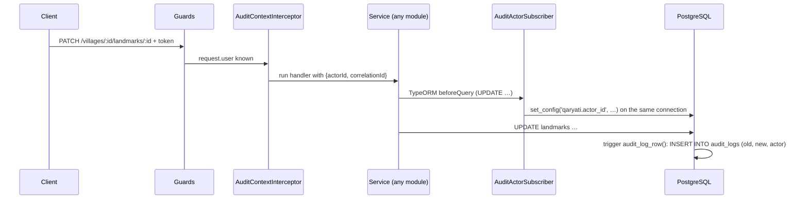

# Audit log

Every insert, update and delete of village data and users is recorded: who
made the change, which record, the values before and after, and when. Other
modules do not call anything for this. The design is explained in
[ADR-005](adr/005-audit-log-with-database-triggers.md).

## What is recorded

Audited tables: `villages`, `village_names`, `sources`,
`population_records`, `history_records`, `landmarks`, `cultural_traits`,
`users`.

Not audited: `refresh_tokens` (security tokens), `audit_logs` itself, and
the `governorates` / `municipalities` reference data.

| Column | Meaning |
|---|---|
| `table_name` | Table of the changed row, e.g. `landmarks` |
| `record_id` | Id of the changed row |
| `action` | `INSERT`, `UPDATE` or `DELETE` |
| `actor_id` | User who made the change; `NULL` outside a request (migrations, seeds, initial admin) or for an anonymous sign-up |
| `correlation_id` | The request's `x-correlation-id`, to find its log lines |
| `old_data` | The row before the change (`NULL` for `INSERT`) |
| `new_data` | The row after the change (`NULL` for `DELETE`) |
| `changed_columns` | Columns whose value changed (`UPDATE` only) |
| `created_at` | When the change was made |

- An update that only changes `updated_at` is not recorded.
- `password_hash` is never stored. A password change shows up as
  `changed_columns: ["password_hash"]` without the values.
- Rows are append-only: the API never changes or deletes them.

## How it works



1. `AuditContextInterceptor` (global) stores the caller and correlation id in
   an `AsyncLocalStorage` context for the request.
2. `AuditActorSubscriber` runs before each `INSERT` / `UPDATE` / `DELETE`
   and passes them to PostgreSQL on the connection that will run the write.
3. The `audit_log_row()` trigger on each audited table writes the audit row.

This works for every way the modules write: repository `save()` and
`remove()`, `update()` / `delete()` with a `WHERE` condition, and raw SQL.

## Reading the log

`GET /api/v1/audit-logs` (`ADMIN` only; `401` without a token, `403` for
other roles). Newest first by default, paginated like every list.

| Query parameter | Example |
|---|---|
| `tableName` | `landmarks` |
| `recordId` | history of one record |
| `actorId` | everything one user changed |
| `action` | `INSERT`, `UPDATE`, `DELETE` |
| `from`, `to` | ISO dates, `from` inclusive, `to` exclusive |
| `page`, `limit`, `order` | `order=asc` for oldest first |

```bash
curl "http://localhost:3000/api/v1/audit-logs?tableName=landmarks&recordId=$ID" \
  -H "Authorization: Bearer $ADMIN_TOKEN"
```

```json
{
  "data": [
    {
      "tableName": "landmarks",
      "recordId": "1cbeb907-…",
      "action": "UPDATE",
      "actorId": "5f0c…",
      "correlationId": "e2e-…",
      "oldData": { "description": "First text", "status": "PENDING", "…": "…" },
      "newData": { "description": "Corrected text", "status": "PENDING", "…": "…" },
      "changedColumns": ["description"],
      "createdAt": "2026-11-27T20:48:36.684Z"
    }
  ],
  "meta": { "page": 1, "limit": 20, "total": 2, "totalPages": 1 }
}
```

## For developers

- **New table with user data:** add a trigger in a **new** migration (never
  edit the merged one):

  ```sql
  CREATE TRIGGER "audit_<table>" AFTER INSERT OR UPDATE OR DELETE ON "<table>"
    FOR EACH ROW EXECUTE FUNCTION audit_log_row();
  ```

  The table needs a uuid `id` column (every `BaseEntity` has one).
- **Secret columns** are removed by the trigger function; add new ones to its
  list in a new migration.
- **Tests** write to audited tables too, so local databases collect audit
  rows from test runs. They are harmless; delete them with
  `DELETE FROM audit_logs;` if needed. CI starts with an empty database.

## Cost

Measured with the authenticated k6 write test: about 15% less write
throughput and 16% higher p95, from one extra small query per write and one
extra row insert. Details: [performance/audit.md](performance/audit.md).

## Limitations

- The audit table only grows; retention or archiving is future work.
- People with direct database access can bypass the API and change audit
  rows. The log protects against mistakes and misuse through the API.
- A table without a trigger is not audited; adding one is a manual step.
