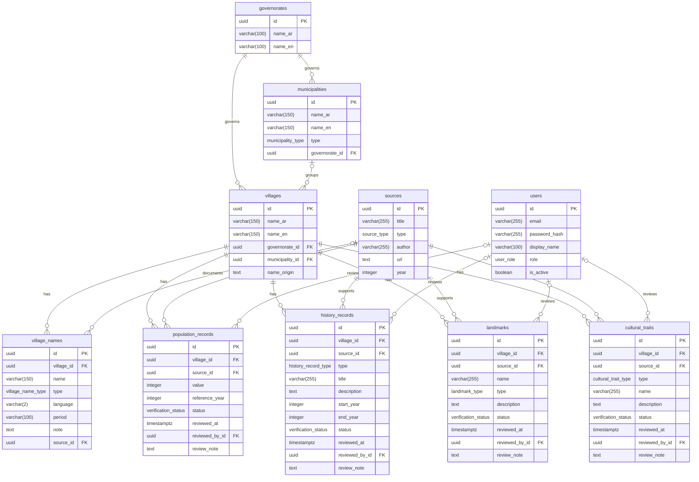

# Database ERD

The diagram reflects the final schema created by the migrations in
`src/database/migrations/`.

Every table also has `created_at` and `updated_at`; these repetitive timestamp
columns are omitted. Optional scalar columns are `municipalities.name_en`;
`villages.name_en` and `name_origin`; `village_names.period` and `note`;
`sources.author`, `url`, and `year`; `history_records.start_year` and
`end_year`; and `reviewed_at` and `review_note` on the verifiable record
tables. Optional foreign keys are shown by the zero-or-one ends of their
relationships. All foreign keys use `ON DELETE RESTRICT` except
`village_names.village_id`, which cascades when a Village is deleted.

## Important constraints

### Governorates and Villages

- `governorates.name_ar` and `governorates.name_en` are each unique.
- Villages are unique by `(governorate_id, name_ar)`. Municipalities are
  unique by `(governorate_id, name_ar)`.
- A Village requires a Governorate. Its Municipality is optional; when set,
  the composite foreign key `(municipality_id, governorate_id)` requires that
  Municipality to belong to the same Governorate. Municipalities also have a
  unique `(id, governorate_id)` key referenced by this foreign key.

### Sources and Users

- `sources.year`, when present, must be between 1 and 2100.
- `users.email` is unique and must be lowercase.

### Village Names

- `(village_id, name)` is unique, and `language` must contain exactly two
  lowercase letters.
- `source_id` is nullable. Deleting a Village cascades to its Village Names;
  deleting a referenced Source is restricted.

### Population

- `value` cannot be negative, and `reference_year` must be between 1 and
  2100.
- `(village_id, reference_year, value, source_id)` is unique.
- A partial unique index allows at most one VERIFIED record per
  `(village_id, reference_year)`.

### History

- `type` is `OVERVIEW` or `EVENT`. A partial unique index allows at most one
  `OVERVIEW` per Village, regardless of verification status.
- An `end_year` requires a `start_year`; year zero is prohibited, each year
  must be at most 2100, and `start_year` must not exceed `end_year` when both
  are set. Negative years are not prohibited by these checks.

### Landmarks and Cultural Traits

- Each record requires a Village and a Source; `reviewed_by_id` is an
  optional foreign key to Users.
- `status` uses the `verification_status` enum (`PENDING`, `VERIFIED`,
  `REJECTED`) and defaults to `PENDING`.

The migrations also add GIN trigram indexes for normalized Village and
Village Name searches.

## Data modeling decisions

- **Conflicting information:** Different sourced factual claims are retained
  as separate records rather than overwriting earlier evidence. The backend
  does not automatically detect contradictions between sources.
- **Data provenance:** Population, History, Landmarks, and Cultural Traits
  require a reference to the shared Source table. This supports traceability
  without duplicating source metadata. A Village Name may also reference a
  Source, but its `source_id` is optional.
- **Verification fields:** Each verifiable fact record stores its own status,
  reviewer ID, review timestamp, and review note because review decisions
  apply to individual records. These fields do not provide a complete audit
  history.

See [ADR-003: Conflict Handling and Data Provenance](adr/003-conflict-handling-and-provenance.md).
